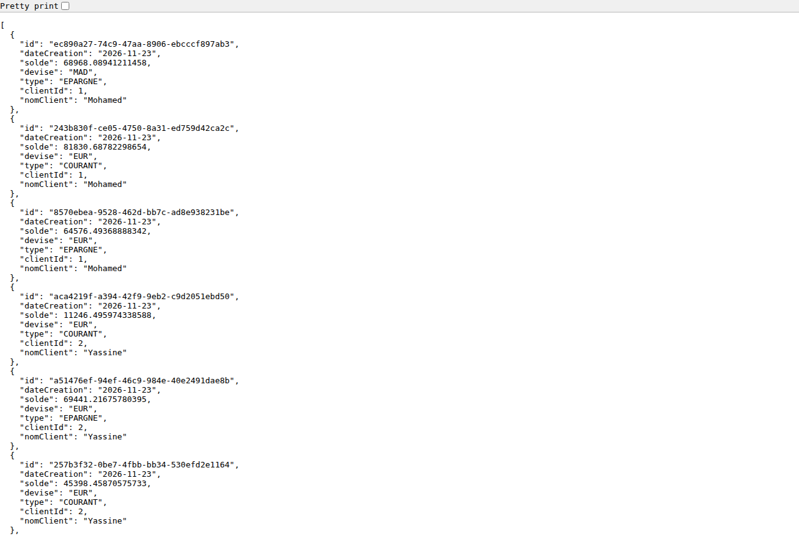
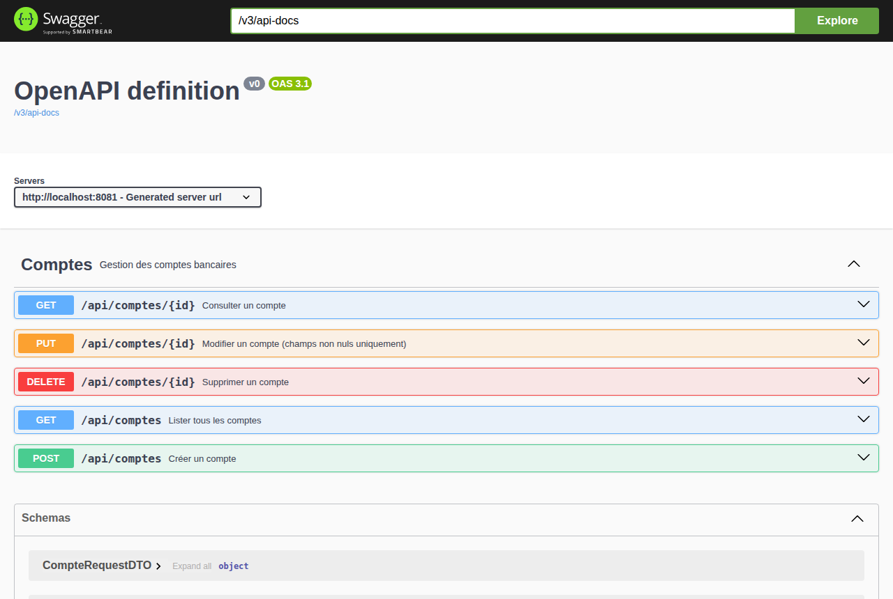
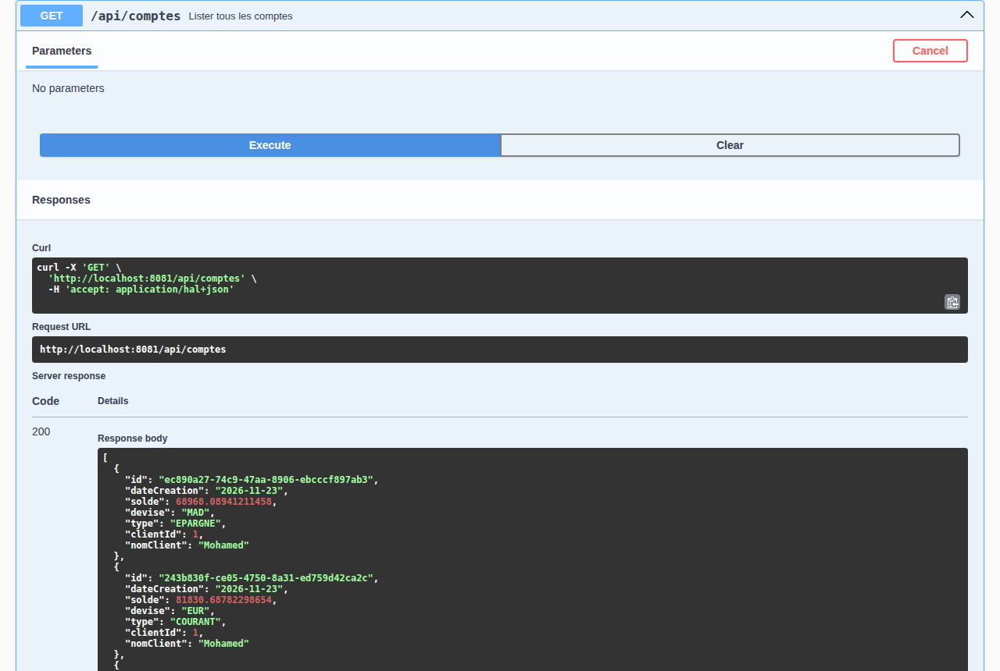
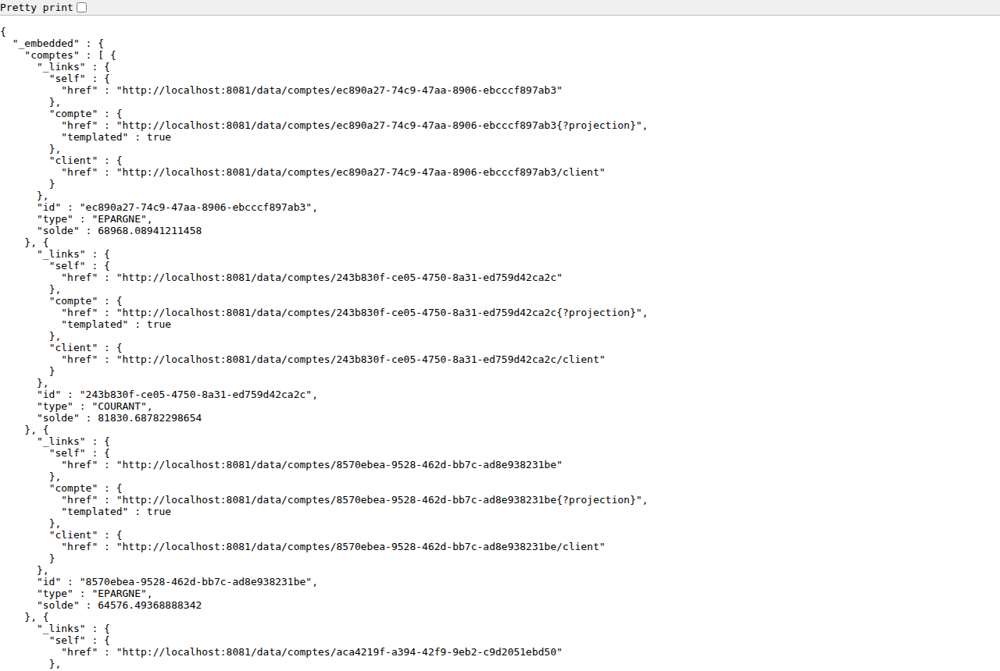
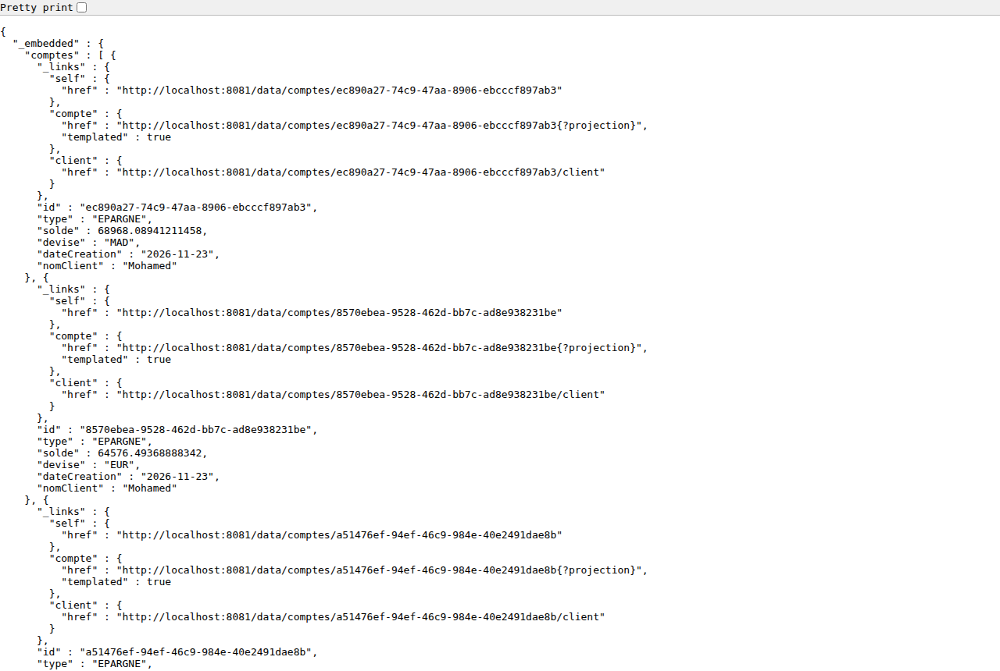
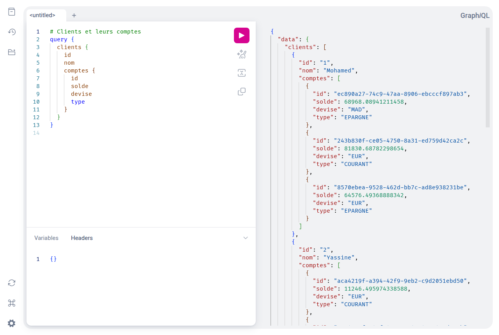
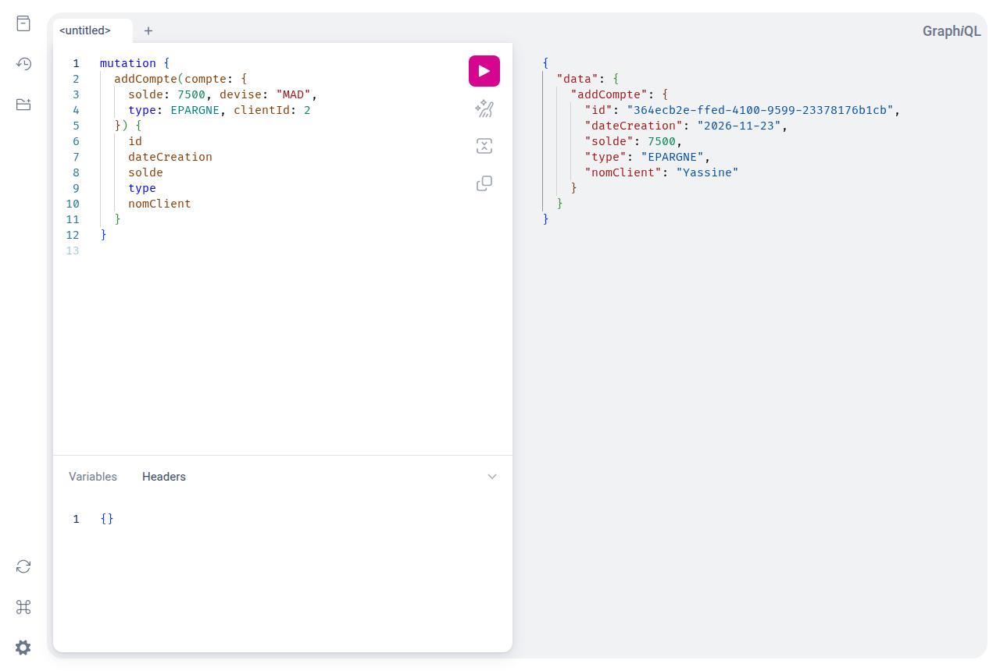
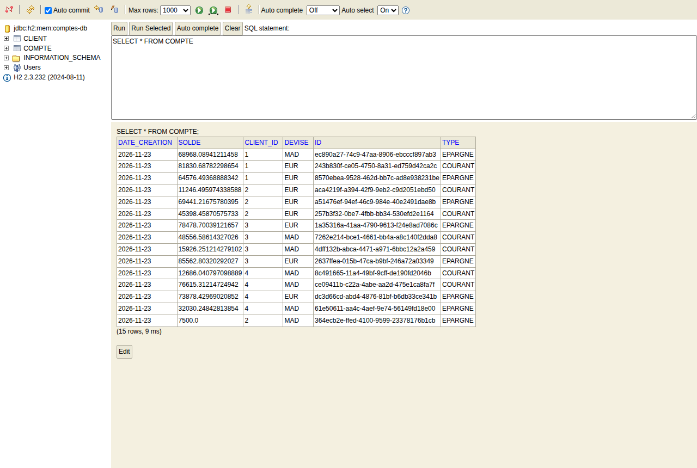

# Bank Account Service : micro-service de gestion des comptes bancaires

Activité pratique N°1 : Spring Boot 3.5 · Spring Data JPA · H2 · Lombok · Spring Data REST · springdoc-openapi 2.8.13 · Spring for GraphQL.

> **Pourquoi Spring Boot 3.5 et pas 4.x ?** La dépendance imposée `springdoc-openapi-starter-webmvc-ui:2.8.13` cible Spring Boot 3.x. Elle ne fonctionne pas avec Spring Boot 4 (qui nécessite springdoc 3.x).

## Structure

```
ma.enset.bankaccountservice
├── entities/       Compte, Client (JPA), CompteProjection (p1), CompteProjectionComplete (complet)
├── enums/          TypeCompte (COURANT, EPARGNE)
├── repositories/   CompteRepository, ClientRepository (Spring Data JPA + @RepositoryRestResource)
├── dto/            CompteRequestDTO, CompteResponseDTO
├── mappers/        CompteMapper (Entity <-> DTO)
├── services/       CompteService / CompteServiceImpl (couche métier)
├── web/            CompteRestController (REST), CompteGraphQLController (GraphQL)
└── exceptions/     exceptions métier + gestionnaires REST (404) et GraphQL
resources/graphql/schema.graphqls   schéma GraphQL
```

Au démarrage, un `CommandLineRunner` insère 4 clients et 2 à 4 comptes par client.

## Lancer

```bash
./mvnw spring-boot:run
```

Port : **8081**

| Étape | URL |
|---|---|
| 5. API REST | `GET/POST /api/comptes`, `GET/PUT/DELETE /api/comptes/{id}` |
| 7. Swagger UI | http://localhost:8081/swagger-ui.html (JSON : `/v3/api-docs`) |
| 8. Spring Data REST | http://localhost:8081/data/comptes?projection=p1 · `/data/comptes/search/byType?t=EPARGNE&projection=complet` · `/data/clients` |
| 11. GraphiQL | http://localhost:8081/graphiql (endpoint : `POST /graphql`) |
| Console H2 | http://localhost:8081/h2-console (JDBC URL : `jdbc:h2:mem:comptes-db`, user `sa`, sans mot de passe) |

## Captures d'écran

### API REST : `GET /api/comptes`


### Documentation Swagger UI


Exécution de `GET /api/comptes` depuis Swagger UI :



### Spring Data REST : projection `p1` (`id`, `solde`, `type`)


### Spring Data REST : recherche `byType` + projection `complet`


### GraphQL : requête `clients` avec leurs comptes


### GraphQL : mutation `addCompte`


### Console H2 : table `COMPTE`


## Tests

```bash
./mvnw test
```

- `CompteRepositoryTest` (étape 4) : test de la couche DAO avec `@DataJpaTest`.
- `BankAccountServiceApplicationTests` : CRUD REST, projections Spring Data REST, documentation OpenAPI et requêtes/mutations GraphQL.

## Postman (étape 6)

Importer `postman_collection.json`. La requête « Créer un compte » enregistre l'`id` créé, que réutilisent les requêtes Consulter, Modifier et Supprimer.

## Exemples GraphQL

```graphql
query {
  comptesList { id solde devise type nomClient }
  clientById(id: 1) { nom comptes { id solde } }
}

mutation {
  addCompte(compte: {solde: 500, devise: "EUR", type: COURANT, clientId: 2}) { id nomClient }
}

mutation { updateCompte(id: "<id>", compte: {solde: 9999}) { id solde } }
mutation { deleteCompte(id: "<id>") }
```
